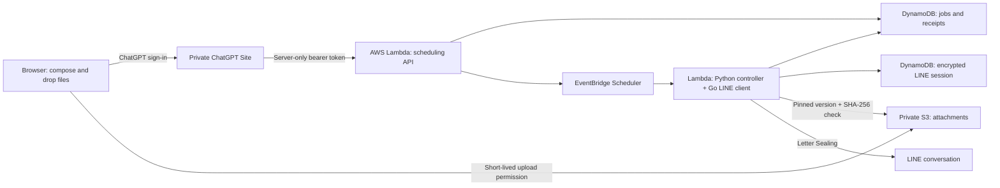

# What runs where?

The goal: write a LINE message now, deliver it later, close the laptop.
Sites supplies the private interface; AWS supplies the clock and sender.
There is no AI agent deciding when or what to send.

## Three logins, three different jobs

| Login | What it does | Where it lives |
| --- | --- | --- |
| ChatGPT | Lets the owner open the private Site | Sites handles browser sign-in and supplies trusted identity headers |
| AWS | Lets the operator deploy and maintain infrastructure | Temporary AWS CLI credentials; not needed for each scheduled send |
| LINE | Lets the sender act as your personal account | Initially approved using a local QR terminal and LINE on your phone; then stored encrypted in AWS |

**The Site does not log you into LINE.** Its “LINE connected” indicator reports the
sender's last connection check. Signing into ChatGPT alone cannot establish a LINE
session, and closing or signing out of the Site does not cancel accepted schedules.

## LINE sign-in, step by step

The currently implemented bootstrap uses Windows DPAPI and a WSL deployment helper:

1. Build the reviewed CLI and Windows migration adapter. Deploy the AWS stack.
2. Before importing a real session, run the synthetic cloud persistence probe.
3. Run `line.exe login --qr` in a private local terminal. Scan the QR with LINE
   on your phone and approve any verification there. Never paste the QR or PIN
   into an issue, chat, screenshot, or repository.
4. Run `python3 deploy.py migrate` from `deploy/aws` in WSL. It reads the local
   Windows credential store, encrypts the session in memory, disables the local
   CLI copy, and transfers the ciphertext to AWS. Your phone remains signed in.
5. The cloud worker restores that session when invoked. Refreshed tokens, keys,
   and request sequences are saved before the client proceeds. You do not scan
   a QR for every message, and your computer can be off after setup.

The encryption key is in the worker Lambda's encrypted environment; the session
ciphertext is in a separate DynamoDB table. The Site holds neither. An AWS
administrator with access to both can decrypt the session, so this is a trusted
personal deployment, not protection from the hosting administrator.

There is **no in-browser LINE login or automatic reconnect wizard yet**. If LINE
revokes the session, sends pause/fail safely. Reconnection requires an operator to
inspect pending jobs, establish a fresh QR session, and replace the cloud session
under the account lease. The ordinary migration command intentionally refuses to
overwrite an existing cloud session. Never restore an old snapshot after the
cloud sender has used it. Logging in may replace another LINE Chrome-style client.

## Sending text and files

1. Choose a conversation, compose text and/or attach files, and select a time zone
   and date. Drag-and-drop and the file picker accept up to five files, 20 MiB each.
2. On submission, the browser hashes each file and obtains a five-minute S3 upload
   form through the authenticated Site relay. Its permission fixes the object key,
   size, encryption setting, and staging tag. File bytes go directly to private S3.
3. AWS records each message as its own job. For attachments it pins an immutable
   S3 version. A later upload cannot change the version scheduled for delivery.
4. EventBridge invokes the worker at the chosen time. The worker claims the job,
   restores the encrypted LINE session, checks attachment size and SHA-256, and
   sends once with Letter Sealing required.
5. The history shows LINE's receipt or a safe failure/uncertain status. Reloading
   or retrying the same submitted job ID does not send a second copy.

Text and each attachment are separate LINE messages and separate jobs. Their
arrival order is not guaranteed. A batch is not an atomic transaction: if a later
submission fails, already accepted messages remain scheduled and appear separately
in history. The interface removes accepted items and preserves remaining draft
items. Check history before creating a new request after an uncertain response.

**Images send as generic files**, preserving their original bytes. Native photo
messages remain disabled because the inherited full-image/preview encryption format
reuses an encryption stream. The scheduler never works around that by downgrading
encryption. Generic-file interoperability is separate from text support.

## Storage and cleanup

| Data | Location | Lifetime |
| --- | --- | --- |
| Unsaved draft | Browser memory | Until refresh/close; no draft sync |
| Job text, recipient, filename, hash, receipt | DynamoDB jobs table | TTL 90 days after due time; deletion is asynchronous |
| File bytes | Private, versioned, server-encrypted S3 bucket | Exact version deleted after completion/cancellation when possible |
| Abandoned upload | S3, tagged staging | Current version expires after one day; noncurrent staging versions after one more day; cleanup is asynchronous |
| Scheduled file left after an interrupted cleanup | S3 | Current versions expire after 370 days; noncurrent scheduled versions after 370 more days (up to about 740 days total) |
| LINE tokens, keys, request sequence | Encrypted DynamoDB session record | Retained for the active account |
| Hosting bridge secret | Sites server runtime and API Lambda | Until rotated; never browser code |

File names and contents are not made public. Generic files retain any metadata
already inside them; the scheduler does not strip EXIF or scan for malware.
Uploading to your AWS account is not end-to-end encryption against AWS: AWS storage
encryption protects files at rest, and LINE Letter Sealing protects the LINE send.

## Timing and failure behavior

AWS scheduling is minute-level, not an exact-second alarm. The account lease
serializes LINE operations; congestion, network problems, or expired credentials
can delay a send. Jobs more than 15 minutes late expire. An ambiguous send becomes
**Check LINE** and is never automatically replayed. This avoids duplicate personal
messages at the cost of possibly missing a send after a failure.

The browser, local terminal, and deployment CLI are not part of scheduled execution.
AWS account suspension or exhausted account-plan access can stop the service.
Low traffic is inexpensive but not a promise of an indefinite zero bill; S3 storage,
requests, logs, and service allowances still apply.

See [deployment and operations](../deploy/aws/README.md) for commands and
[security review limits](FORK_SECURITY.md) before using a personal account.
